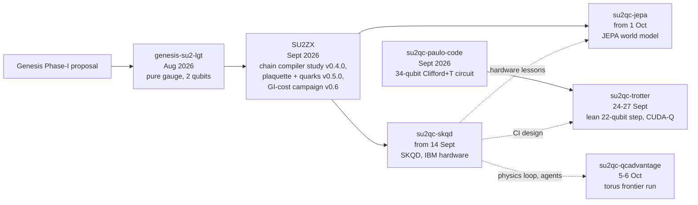

# Package lineage

| from → to | what was inherited |
|---|---|
| [[genesis-su2-lgt]] → everything | one canonical Hamiltonian feeding all backends; gate tables; [[Graphify code graph]]; "no guessed physics" rule |
| [[SU2ZX]] → [[su2qc-jepa]] | verified `su2qc` physics code (cross-check target), conventions of 9 Sept, the twin-seed lesson |
| [[SU2ZX]] → [[su2qc-skqd]] | the one-plaquette-with-matter system, the 82-state count, the lesson that the L12 circuits are too deep |
| [[genesis-su2-lgt]] → [[SU2ZX]] | Codex workflow (`AGENTS.md`), the Graphify harness, the step-5 plaquette chain |
| Genesis research ladder step 6–7 → skqd, jepa | staggered fermions, meson/baryon observables, string breaking, dressed-site basis |
| [[su2qc-skqd]] → [[su2qc-jepa]] | Claude Code agent routing, numbered prompts, Perlmutter use (both now share the same working style) |
| [[su2qc-paulo-code]] → [[su2qc-trotter]] | the Eq. 39 34-qubit circuit (kept in `reference/`) as the baseline to beat |
| [[su2qc-skqd]] → [[su2qc-trotter]] | the GitHub-to-Perlmutter CI design (`skqd-ci` → `trotter-ci`, separate key, poll minute :37) |
| (new model) → [[su2qc-qcadvantage]] | different physics: pure-gauge one-qubit-per-plaquette model from [[Ciavarella et al. 2026]], not the 2×2 plaquette with quarks; inherits the Claude Code physics loop (locked acceptance tests, audits) |

Workflow drift worth knowing: genesis-su2-lgt and SU2ZX v0.4.0 were built with **Codex** (`AGENTS.md`); SU2ZX
Section 8 and the GI-cost campaign with the **Hermes** orchestrator; su2qc-skqd and su2qc-jepa with **Claude Code**
(`CLAUDE.md`, `.claude/agents`).
